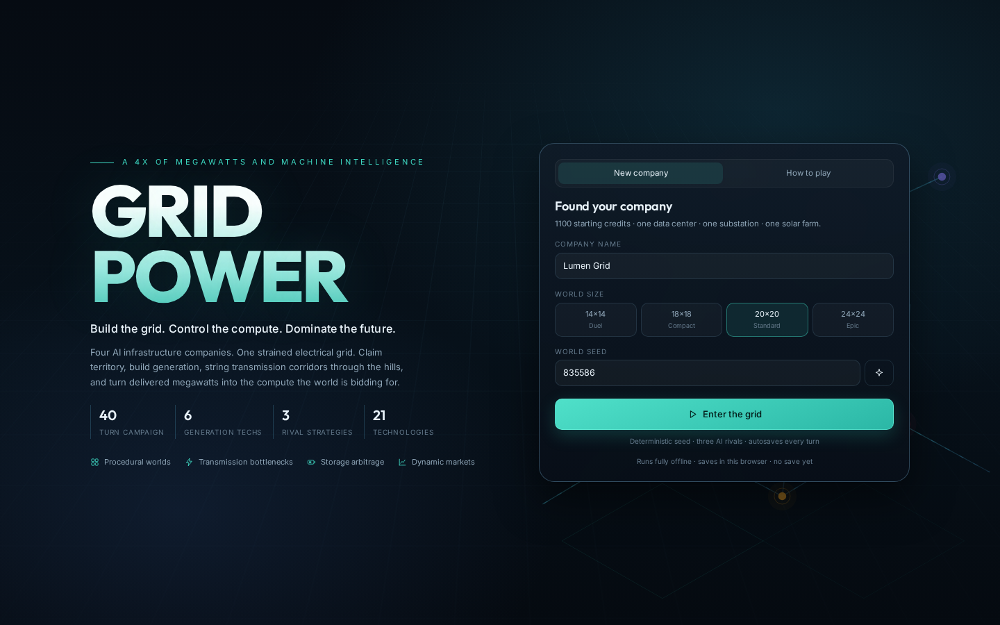
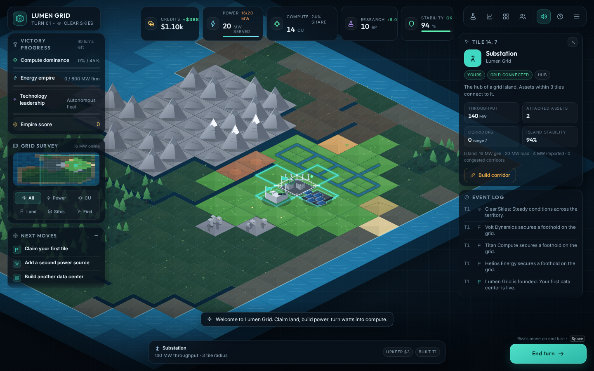
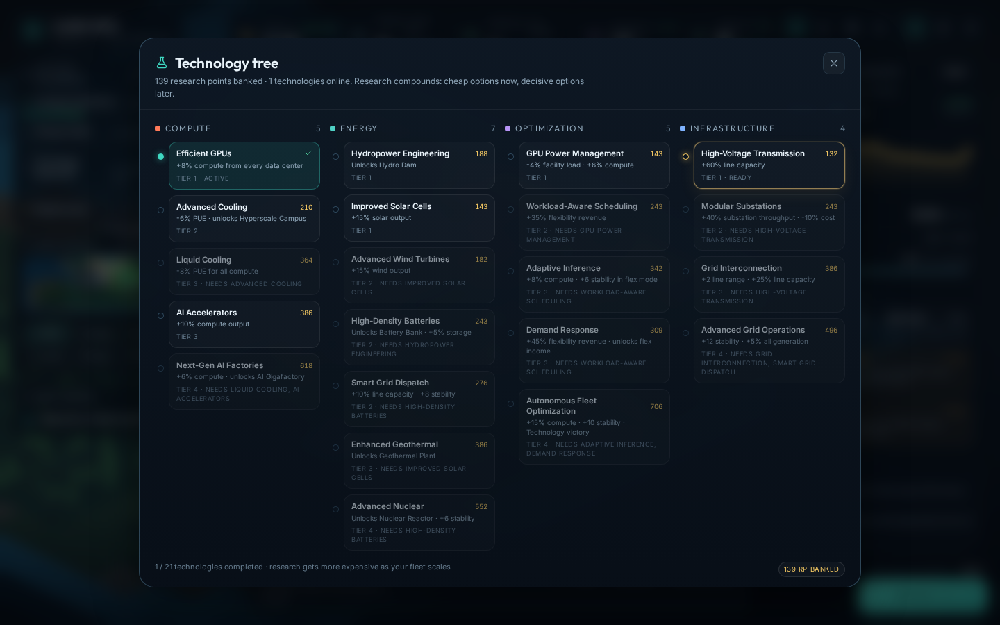
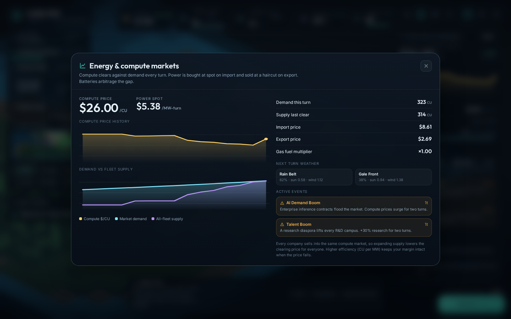
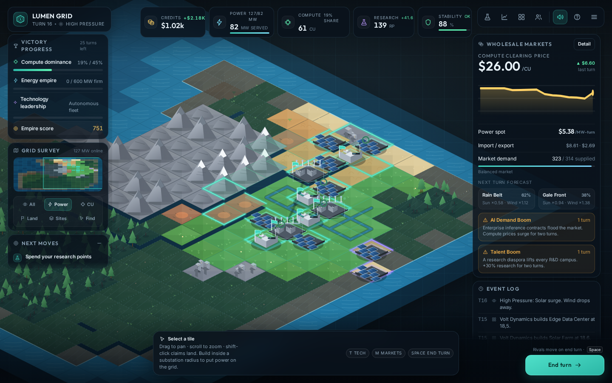
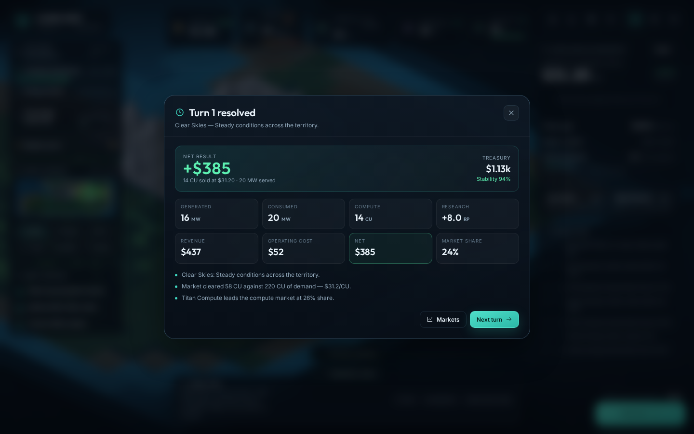
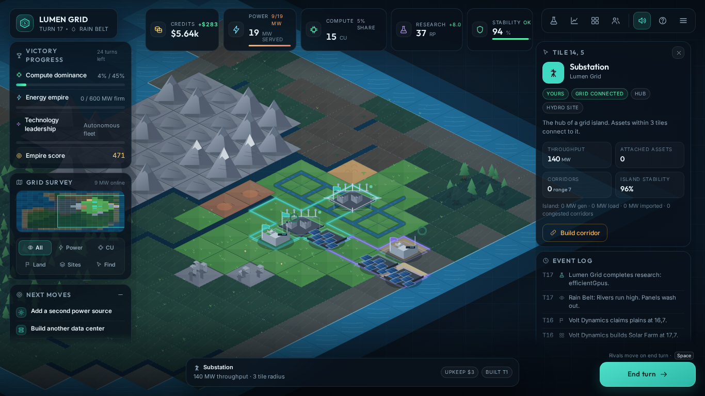

# GRIDPOWER

**Build the grid. Control the compute. Dominate the future.**

GRIDPOWER is a complete, single-player, turn-based 4X strategy game about AI infrastructure companies racing to build the most valuable compute empire on a shared electrical grid. Claim land, build generation, string transmission corridors through the hills, and turn delivered megawatts into AI compute before three rival companies do.


Runs entirely locally in a browser. No account, backend, API key, or network access is required at runtime. Worlds are procedural and seeded; saves live in the browser.

---

## Quick start

Requirements: **Node.js 22.12+** and npm. The project is TypeScript + React 19 + Vite 7, with a custom Canvas 2D isometric renderer. All art, sound and maps are generated by the game — there are no third-party game assets.

```bash
npm install
npm run dev          # http://localhost:5173
```

Production build and local preview:

```bash
npm run build        # type-check + bundle to dist/
npm run preview      # serve the production bundle
```

A production build of the current source is included in `dist/`.

If port 5173 is busy, Vite will pick the next free port; use the URL it prints.

---

## Scripts

| Command | What it does |
|---|---|
| `npm run dev` | Vite development server with HMR |
| `npm run build` | Type-check the whole project, then build `dist/` |
| `npm run preview` | Serve the production bundle |
| `npm test` | 25 Vitest engine tests (grid, dispatch, storage, research, territory, AI legality, victory, saves, determinism) |
| `npm run sim` | Headless AI league. Configurable: `npm run sim -- seeds=10 turns=40 size=20` |
| `npm run e2e` | Real-browser regression run: menu → new game → claim → build → research → save/reload → full 40-turn campaign. Starts its own Vite server if needed |
| `npm run shots` | Re-captures the screenshot set in `screenshots/` from the running game |

Browser scripts use Playwright's Chromium. If it is not installed yet:

```bash
npx playwright install chromium
```

Set `BASE_URL=http://127.0.0.1:5173/` to point the browser scripts at an already-running server; otherwise they reuse `.tmp/dev.port` or start a private Vite instance on a free port.

---

## What you are doing

You run one of four AI infrastructure companies. Each turn is an operating period:

1. **Claim territory.** Every asset needs land. Claims must border your territory, reveal nearby tiles, and get more expensive with each claim.
2. **Generate power.** Solar, wind, gas, hydro, nuclear and geothermal each behave differently. Weather moves renewable output; fuel prices move gas.
3. **Transmit it.** Assets connect to a substation within 3 tiles. Corridors join substations into grid islands. Lines and substations have real capacity limits.
4. **Convert to compute.** Data centers draw IT power × PUE. Delivered power becomes compute, which sells into a shared market. Demand, supply and events set the clearing price.
5. **Research and specialise.** Twenty-one technologies across compute, energy, optimization and infrastructure change the economics.
6. **Compete.** Three AI companies with distinct strategies expand, build, research and fight for market share.

**Win** by holding 45% of the compute market for three turns, by running a 600 MW firm fleet with 70% stability and $9,000 in the bank for three turns, by completing the autonomous fleet technology and sustaining efficient compute, or by leading the score at turn 40. Deep insolvency ends a run.

### Starting position

One substation, one solar farm, one edge data center, five tiles of territory, $1,100 and 10 research points. The first five turns are designed to teach the loop through contextual objectives rather than a wall of tutorial text.

---

## Controls

| Action | Input |
|---|---|
| Pan | Drag, WASD or arrow keys |
| Zoom | Scroll wheel, `+` / `-` |
| Select tile | Click |
| Claim tile | Select it and press **Claim**, or Shift-click |
| Build | Select an owned empty tile, choose from the bottom palette |
| End turn | **Space** / **Enter** / the End turn button |
| Technologies | `T` |
| Markets | `M` |
| Company report | `E` |
| Rivals | `R` |
| Help | `H` or `F1` |
| Map layers | `1` power, `2` compute, `3` territory, `4` sites |
| Cancel / close | `Esc` |
| Recentre on your grid | `F` |

---

## Screens

| | |
|---|---|
|  |  |
| Main menu | Your first operating period |
|  |  |
| Technology tree | Energy and compute markets |
|  |  |
| Power layer | Turn summary |
|  |  |
| Winning the campaign | Laptop layout, 1366×768 |

## Feature tour

- **Procedural worlds** with coherent continents, rivers, mountain ranges, metro districts, geothermal fields and gas basins. Four starts are spaced by farthest-point sampling so no one is boxed in.
- **A real network model.** Islands are connected components of substations joined by built corridors. Dispatch is solved as a min-cost max-flow problem, so transmission bottlenecks, substation throughput and import rights all matter.
- **Transmission is not cosmetic.** Corridors carry animated flow; congested lines turn amber and hurt grid stability. Clicking a substation shows its island's generation, load, imports and stability.
- **Data center economics.** Three tiers with different PUE and compute efficiency. Weather, terrain cooling and every facility's operating policy change the draw and the output.
- **Five operating policies** per site or for the whole fleet: maximize compute, maximize profit, minimize energy cost, grid flexible, reliability first.
- **Batteries** store surplus, discharge into load, and provide flexibility. State of charge is conserved with a 90% round trip.
- **Markets and weather.** The next turn's weather is forecast with two weighted candidates. Compute prices fall as fleet supply rises; power is imported at a premium and exported at a haircut. Eight event types, from AI demand booms to grid emergencies.
- **Twenty-one technologies** in four branches, with real unlocks (hyperscale campuses, gigafactories, nuclear, geothermal, batteries, high-voltage corridors) and real trade-offs.
- **Three rival personalities** — renewable developer, hyperscaler, grid operator — driven by a utility-based planner.
- **Presentation.** Custom isometric art for every structure, animated turbines, cooling fans, solar shimmer, server LEDs, transmission flow, weather particles, construction effects, a minimap, four analysis overlays, and a full turn summary.
- **Offline, local, deterministic.** Seeded maps and event sequences. Save and continue from the in-game menu.

---

## Project structure

```
src/
  engine/        deterministic simulation (no DOM)
    types.ts         authoritative state & value types
    config.ts        every balance constant, structure, tech, weather, persona
    rng.ts           serialisable xorshift + value noise
    worldgen.ts      seeded continents, biomes, rivers, starts, neutral assets
    board.ts         geometry and tile queries
    progression.ts   tech effects, build/claim/link legality and costs
    grid.ts          islands, min-cost-flow dispatch, stability, batteries
    markets.ts       prices, weather, forecasts, events
    actions.ts       the only mutation entry point for player/AI actions
    simulation.ts    turn pipeline, settlement, victory, score
    ai.ts            utility AI for the three rivals
    save.ts          versioned local saves with defensive parsing
    headless.ts      complete AI-only matches for tests and the league
  render/        Canvas 2D isometric renderer and procedural structure art
  ui/            React HUD, panels, modals, minimap, charts, icons
  state/         Zustand store bridging the engine and the UI
  audio/         WebAudio sound effects and ambient music
tests/           25 Vitest tests
scripts/         headless league, end-to-end browser run, screenshots
```

`GAME_DESIGN.md` explains the mechanics and design intent. `ARCHITECTURE.md` explains the simulation and rendering pipeline. `BALANCE.md` documents the numbers and the results of simulated matches.

---

## Testing and validation

```bash
npm test        # 25 engine tests
npm run sim     # 10 complete AI matches with balance metrics
npm run e2e     # real clicks, save/reload, and a full campaign
```

The engine tests cover generation determinism and start fairness, territory legality and escalating claims, terrain and tech build rules, PUE-adjusted data center load, import ordering, island merging through corridors, corridor/substation capacity limits, off-grid assets, battery conservation, research gating, all three victory paths, insolvency, save round-trips, whole-turn determinism and AI action legality over full matches.

The headless league runs complete matches with four AI companies, checking for crashes, stalled economies, impossible victories, runaway credits and long resolution times. The e2e run drives the real UI at 1440×900 and 1366×768.

---

## Saves

Progress autosaves to `localStorage` (`gridpower.save.v1`) after every action and at the end of every turn. "Continue" on the main menu resumes it. No cloud, no account. Clearing browser storage clears the campaign.

---

## Known limitations

- Single-player only; no online play or cloud saves.
- The grid model is a min-cost-flow approximation, not an AC power-flow solver. Voltage, reactive power and frequency dynamics are abstracted into capacity, imports and stability.
- One difficulty level, expressed through the three rival personalities rather than selectable handicaps.
- The AI is a heuristic utility planner, not a lookahead search; it is competent and fast (all three rivals act in a few milliseconds) but not a grandmaster.
- Audio is synthesized in WebAudio; there are no recorded assets.

All artwork, maps, names and audio in this project are original and generated procedurally.

---

## Session summary

**SESSION SUMMARY — b839acbefedd3f0a02f938cd (deepseek-v4.1-flash, default tier)**

Window: 2026-10-25 02:18:44 → 02:48:55 UTC (30.4 min wall, 10.3 min busy, 5.20 turns/min)

Tokens (158 turns, 156 tool_calls + 2 stop):
- prompt 71,885,972 | cached 70,396,544 (97.9% hit) | uncached 1,489,428 | completion 178,047

Energy & cost:
- 0.120599 kWh | billed $0.0000 — ARTIFACT, not free: every turn reports `charged_energy_kwh > 0` with `cost_usd = 0` (pricing path stamped zero; likely the dsv4f free-use daily grant, which resets 00:00 UTC, or a zero-multiplier promo). Like-priced energy charge at $5.00/kWh: $0.6030.
- Token-card equivalent at listed rates: $1.3862.

Latency / throughput:
- TTFT p50 1.21s, p90 2.08s, p99 6.1s, max 9.8s
- Per-turn generation TPS (turns with ≥1s decode, n=93): mean 467 | p10 343 | p50 449 | p90 632 | max 813
- Session-aggregate TPS: 460.5 generation basis / 97.6 wall-clock

Pool co-tenancy (other-customer same-model standard-pool rows, NULL tier coalesced):
- 20,871 rows fleet-wide in window. Concurrent others at arrivals: median 8, p90 13, max 22 — every turn shared the pool. Earlier "ran alone" reading was a query bug (NULL priority_tier excluded); corrected above.

Head-to-head vs speed session (same base model, ~same task shape):
- decode p50 449 vs 615 tps (-27%), wall-clock 97.6 vs 168.9 (-42%), TTFT tail better (p99 6.1s vs 14.1s) — busier pool but flatter latency; energy per 1k output tokens 0.68 vs 0.48 Wh (-42% efficiency for default).
